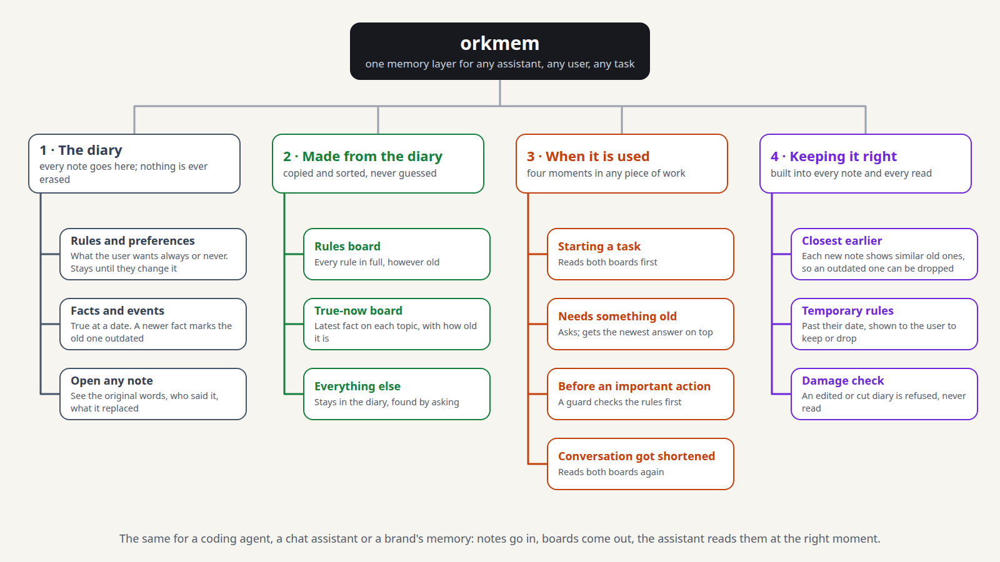

<div align="center">

# orkmem

Permanent memory for AI agents. Rules stay whole, outdated facts never pass as current.
One Python file, no dependencies.


</div>

Your agent runs `memo` from its shell:
- **While working**, it writes one-line notes.
- **At the start of every session, and after every compaction**, it reads its rules and current facts back.
- **When it needs something older**, it asks for it.

The user never has to maintain anything.



## 🚀 Install

```sh
git clone https://github.com/orkait/orkmem
sh orkmem/install.sh
```

This puts the tool at `~/.orkmem/memo` and the memory at `~/.orkmem/memory`. It also prints a short `## Memory` block: paste it into your agent's `AGENTS.md` or `CLAUDE.md`. Run the installer again to update; your memory is never touched. Put `~/.orkmem` on your `PATH` to type `memo`.

## 🧭 Use

```sh
memo wake                                         # start of a session: rules, open items, current facts
memo note --rule --user "Never merge without my OK"   # something the user wants, always
memo note --subject app.version "Live: 9de29cb"   # a fact that can change; the newer one replaces it
memo note "Chose Postgres over SQLite: one store"  # anything else worth keeping
memo ask deploy version                           # search: current entries first
memo open 9cfa28cd                                # one entry, with what it replaced
memo drop 72fb92eb "wrong host"                   # retire a wrong entry
```

## 📝 How it stays correct

| | |
|---|---|
| Two kinds of entry | A **rule** holds until it is replaced. A **fact** is true as of its date, and a newer fact on the same subject replaces it |
| Rules are never shortened | `wake` shows every rule in full, newest first; where two conflict, the newer wins |
| Only the user changes the user's rules | The agent cannot drop them, only record the user's new rule with `--replaces` |
| Rules stay few on their own | When rules outgrow their budget, `memo` asks the agent to merge two that overlap, or mark them `distinct`. A merge that loses a "never", "not" or "must", or adds a fact none of the rules held, is refused |
| Nothing is lost | The log is append-only. Replaced entries stay readable with `memo open` |
| Damage is refused | Each entry carries a hash of itself and of the one before. An edited or truncated log is refused, not served |
| Output fits | Every page is at most 10,000 bytes; search returns 20 results a page |

## 🛡️ Enforce a rule with a hook

A rule written with `--guard <regex>` can block matching tool calls when `memo guard` runs as a Claude Code `PreToolUse` hook:

```json
{"hooks": {"PreToolUse": [{"matcher": "Bash", "hooks": [{"type": "command", "command": "\"$HOME/.orkmem/memo\" guard"}]}]}}
```

```sh
memo note --rule --user --guard '^gh pr merge' "Merge only after the user's OK"
```

## 🔁 Coming from OptMem

```sh
MEMORY_DIR=~/.orkmem/memory memo import ~/.optmem/memory
```

Every OptMem memory is kept with its number (`memo open '#12'`). Running it again adds only new notes, so it can catch up while old sessions finish.

## ⚠️ Limits

| Limit | Detail |
|---|---|
| Speed | Each command reads the whole log: 0.05 s at 2,500 entries, 0.85 s at 100,000 |
| Platforms | Linux and macOS |
| Search | It matches words: "festival" does not find "Diwali" |

## 🧪 Tests

```sh
python3 test.py
```

## 📄 License

MIT. See [LICENSE](LICENSE).

## 🙏 Credits

orkmem grew out of [OptMem](https://github.com/VictorTaelin/OptMem) by [Victor Taelin](https://github.com/VictorTaelin): a permanent, append-only memory that an agent uses through one small script and a short prompt. orkmem keeps that idea and was written from scratch; it contains no OptMem code.
